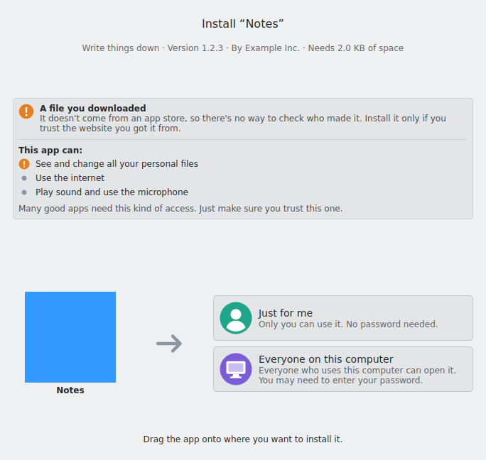
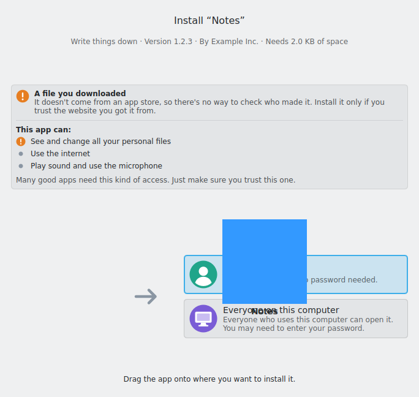
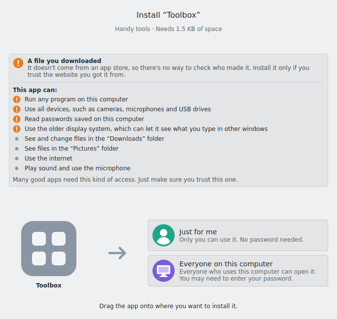
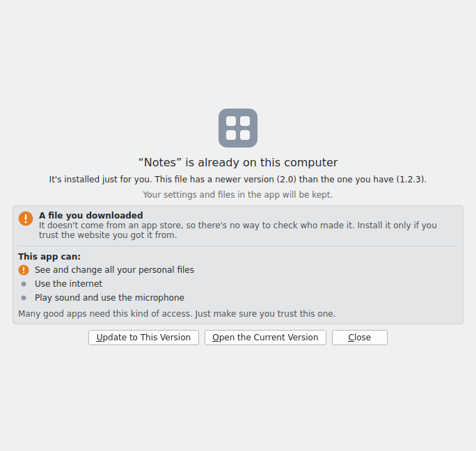
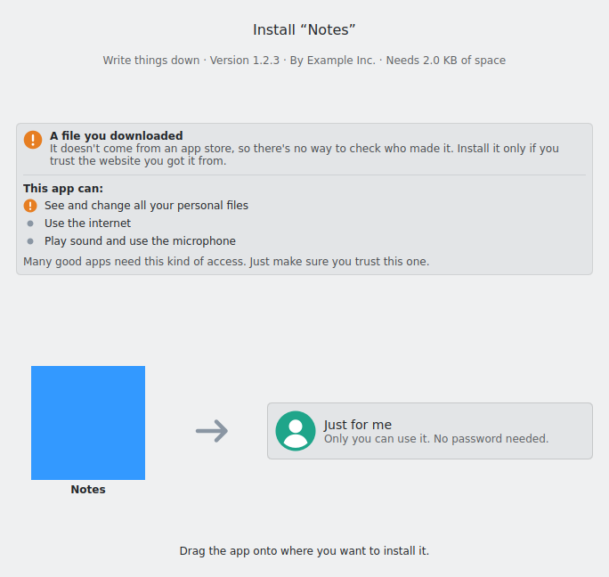

# Flatpak File Installer

English | [繁體中文](README.zh-TW.md)

Install apps on Linux the way you would on a Mac, even if you know nothing about Linux. Double-click a downloaded `.flatpak` or `.flatpakref` file (or drag it onto the window), then drag the app onto "Just for me" or "Everyone on this computer". Before installing, it explains in plain words where the app comes from and what it can access. If the app is already installed, it explains how the versions differ and lets you open, update or replace it. Missing components (runtimes) are downloaded from Flathub automatically.

| Ready to install | Dragging | Installed |
|---|---|---|
|  |  |  |

| Source and permissions, before installing | Already installed | Dropping a file onto the window | SteamOS: "Everyone on this computer" is hidden |
|---|---|---|---|
|  |  |  |  |

> The app uses your system language; the screenshots show the English interface. They were taken on a virtual display without a KDE theme; on Plasma the app uses your system's look.

## Status

Version 1.0.0. For which requirements are done and which are still open, see [`docs/requirements.md`](docs/requirements.md) (in Traditional Chinese, see [About the documentation](#about-the-documentation)).

- "Just for me" runs `flatpak install --user`; "Everyone on this computer" runs `--system`.
- Distributed as a Flatpak (aiming for Flathub) and as an AppImage, for x86_64 and aarch64.
- Mainly targets KDE Plasma, Fedora 44 (immutable) and SteamOS.

## About the documentation

This README is available in English and Traditional Chinese. The development documents, [`docs/requirements.md`](docs/requirements.md) and [`spike/README.md`](spike/README.md), are written in Traditional Chinese only. The original author's native language is Chinese, and they work with an AI coding agent in Chinese, so the requirements, design notes and pull request descriptions came out in Chinese.

The code, code comments, commit messages and user interface source strings are all in English.

## How it works

```
.flatpak / .flatpakref
        │  read the file (without installing): name, icon, version, required runtime
        ▼
  PackageFile ──► Installer ──► QML interface (Kirigami, drag to install)
                     │
                     │  runs on the host:
                     │    flatpak --installations
                     │    flatpak info <runtime>        ← is the runtime installed?
                     │    flatpak remotes               ← is Flathub set up?
                     │    flatpak list                  ← is the app already installed?
                     │    flatpak remote-info …         ← permissions of a .flatpakref
                     │      (asks flathub.org/api/v2/summary/… when the remote isn't set up)
                     │    pkcheck --action-id …         ← whether to offer "Everyone on this computer"
                     │    flatpak remote-add flathub …  ← only when a runtime is missing
                     │    flatpak install --user|--system …
                     ▼
               HostCommand
                 Flatpak: flatpak-spawn --host …
                 AppImage: runs directly, without the AppImage's own library paths
```

| File | Purpose |
|---|---|
| `src/packagefile.*` | Reads `.flatpak` (a GVariant in OSTree static delta format) and `.flatpakref` (a key file) |
| `src/bundlecontents.*` | Reads single files, such as the app's icon, out of a `.flatpak` without installing it |
| `src/hostenvironment.*` | Decides whether system-wide installs are possible: host distribution, polkit authorization |
| `src/hostcommand.*` | Runs commands on the host |
| `src/flatpakcli.*` | Builds the arguments for `flatpak` |
| `src/permissions.*` | Works out an app's permissions and source from its metadata |
| `src/permissiontext.*` | Turns permissions and source into plain, translated text |
| `src/existinginstall.*` | Finds an installed copy and compares it with the one in the file |
| `src/flathubclient.*` | Asks Flathub's website for a `.flatpakref`'s permissions when its remote isn't set up |
| `src/icondownloader.*` | Downloads the icon a `.flatpakref` links to |
| `src/installer.*` | State and actions for the QML interface |
| `src/filedroparea.*` | Accepts files dragged in from a file manager or browser |
| `src/qml/` | User interface |
| `po/` | Translations |
| `packaging/` | Flatpak manifest and AppImage build script |

## Building

Requires Qt 6.8 or later, KDE Frameworks 6.9 or later (Kirigami, KI18n, KCoreAddons, KArchive), GLib, gettext and Extra CMake Modules. For the full package list on Ubuntu 26.04, see [`.github/workflows/ci.yml`](.github/workflows/ci.yml).

```sh
cmake -S . -B build -G Ninja
cmake --build build
QT_QPA_PLATFORM=offscreen ctest --test-dir build --output-on-failure
./build/bin/flatpak-file-installer path/to/app.flatpak
```

`installtest` installs test apps into a temporary directory with the real `flatpak` command. It is skipped when `flatpak` or `busybox` isn't available.

### Flatpak

```sh
flatpak-builder --user --install --force-clean build-flatpak packaging/flatpak/io.github.yuanliou.FlatpakFileInstaller.yml
```

### AppImage

```sh
packaging/appimage/build-appimage.sh
```

## Translations

Source strings are in English; translations live in `po/<language code>.po`.

- After changing text in the interface, run `scripts/update-translations.sh`, then update each language's `.po` file. CI checks that the translation files match the code.
- To add a language, add its code (for example `ja`) to `po/LINGUAS`, run `scripts/update-translations.sh`, and translate the new `po/ja.po`.
- The `.desktop` file and the AppStream metainfo are translated from the same `.po` files.

Guideline: readers know nothing about Linux. Use everyday words and avoid technical terms.

## License

[Apache License 2.0](LICENSE). The AppStream metainfo is licensed under CC0-1.0.
