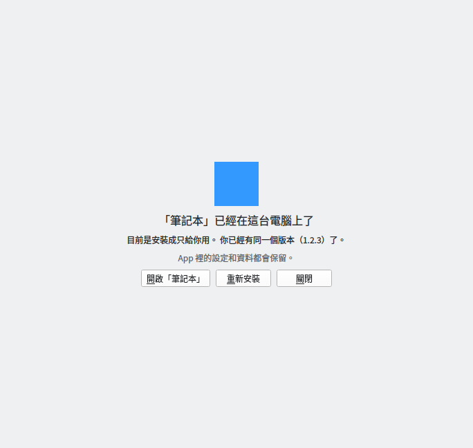
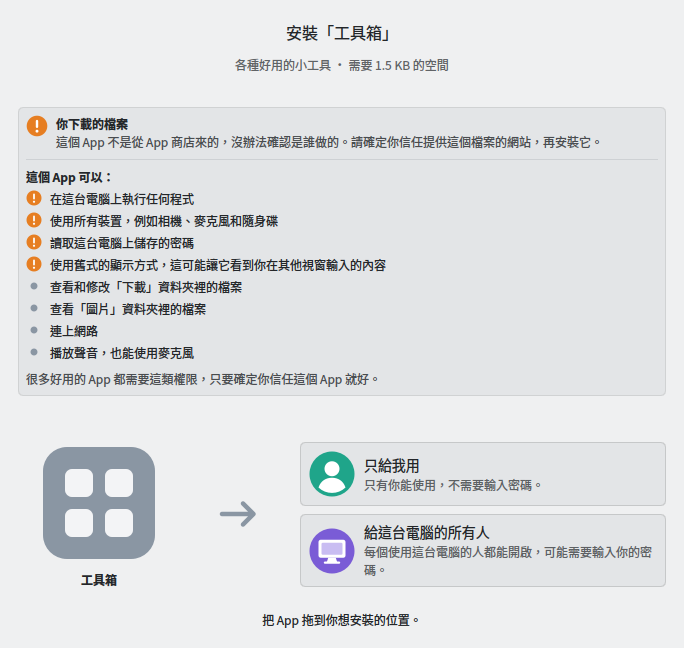
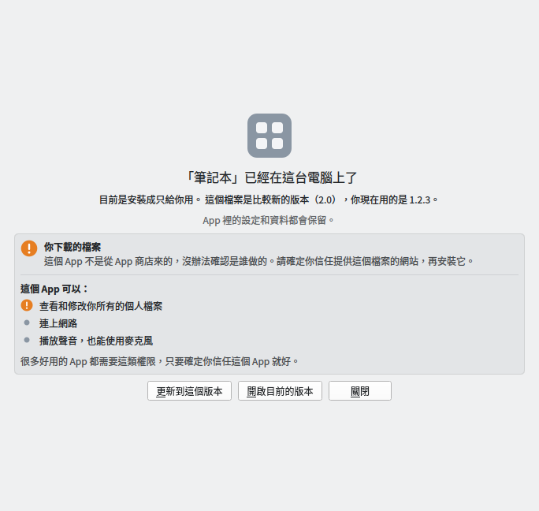
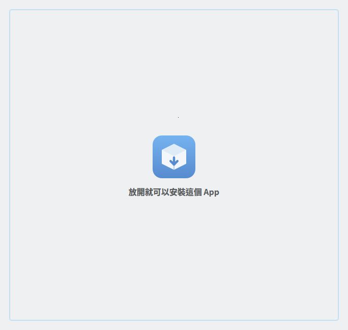
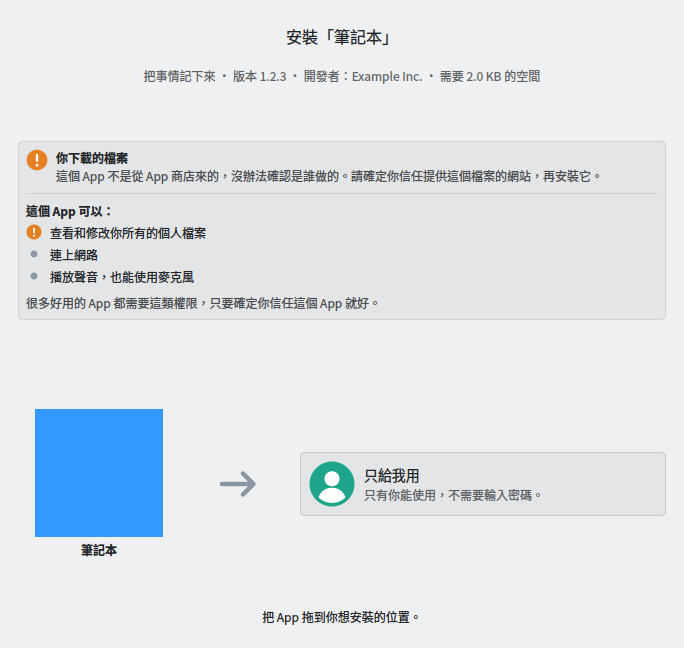

# Flatpak File Installer

[English](README.md) | 繁體中文

讓完全不懂 Linux 的人，也能像在 Mac 上一樣安裝 App：在下載好的 `.flatpak` 或 `.flatpakref` 檔案上按兩下（或把檔案拖進視窗），再把 App 拖到「只給我用」或「給這台電腦的所有人」就好。安裝前會用白話說明 App 從哪裡來、可以存取哪些東西；已經裝過的話，會說明版本差在哪裡，讓使用者選擇開啟、更新或替換；缺少的元件（runtime）會自動從 Flathub 下載。

| 準備安裝 | 拖曳中 | 安裝完成 |
|---|---|---|
|  |  |  |

| 安裝前列出來源與權限 | 已經裝過時 | 把檔案拖進視窗 | SteamOS：自動隱藏「給這台電腦的所有人」 |
|---|---|---|---|
|  |  |  |  |

> 截圖是在沒有 KDE 桌面主題的虛擬螢幕上拍的；在 Plasma 上會套用系統的外觀。

## 狀態

v0.1.0 開發中的骨架。已完成與尚未完成的需求見 [`docs/requirements.md`](docs/requirements.md)。

- 「只給我用」對應 `flatpak install --user`，「給這台電腦的所有人」對應 `--system`。
- 發布方式：Flatpak（目標是上架 Flathub）與 AppImage，支援 x86_64 與 aarch64。
- 以 KDE Plasma、Fedora 44（不可變系統）與 SteamOS 為主要目標。

## 運作方式

```
.flatpak / .flatpakref
        │  解析檔案（不安裝）：名稱、圖示、版本、需要的 runtime
        ▼
  PackageFile ──► Installer ──► QML 介面（Kirigami，拖曳安裝）
                     │
                     │  在主機上執行：
                     │    flatpak --installations
                     │    flatpak info <runtime>        ← runtime 裝了沒
                     │    flatpak remotes               ← Flathub 設定了沒
                     │    flatpak list                  ← 是不是已經裝過
                     │    flatpak remote-info …         ← .flatpakref 的權限
                     │      （遠端沒設定時改問 flathub.org/api/v2/summary/…）
                     │    pkcheck --action-id …         ← 決定要不要顯示「系統」
                     │    flatpak remote-add flathub …  ← 只在缺 runtime 時
                     │    flatpak install --user|--system …
                     ▼
               HostCommand
                 Flatpak 版：flatpak-spawn --host …
                 AppImage 版：直接執行，並移除 AppImage 自己的函式庫路徑
```

| 檔案 | 用途 |
|---|---|
| `src/packagefile.*` | 讀取 `.flatpak`（OSTree static delta 格式的 GVariant）與 `.flatpakref`（key file） |
| `src/bundlecontents.*` | 不必安裝，就能從 `.flatpak` 裡讀出單一檔案，例如 App 的圖示 |
| `src/hostenvironment.*` | 判斷能不能安裝到系統：主機發行版、polkit 授權結果 |
| `src/hostcommand.*` | 在主機上執行指令 |
| `src/flatpakcli.*` | 組出 `flatpak` 指令的參數 |
| `src/permissions.*` | 從 metadata 整理出 App 的權限與來源 |
| `src/permissiontext.*` | 把權限與來源寫成白話的翻譯文字 |
| `src/existinginstall.*` | 找出已安裝的版本，並和檔案裡的版本比較 |
| `src/flathubclient.*` | 遠端還沒設定時，向 Flathub 網站查詢 `.flatpakref` 的權限 |
| `src/icondownloader.*` | 下載 `.flatpakref` 指向的圖示 |
| `src/installer.*` | 給 QML 用的狀態與操作 |
| `src/filedroparea.*` | 接收從檔案管理員或瀏覽器拖進視窗的檔案 |
| `src/qml/` | 介面 |
| `po/` | 翻譯 |
| `packaging/` | Flatpak manifest 與 AppImage 建置腳本 |

## 建置

需要 Qt 6.8 以上、KDE Frameworks 6.9 以上（Kirigami、KI18n、KCoreAddons、KArchive）、GLib、gettext 與 Extra CMake Modules。Ubuntu 26.04 上的完整套件清單見 [`.github/workflows/ci.yml`](.github/workflows/ci.yml)。

```sh
cmake -S . -B build -G Ninja
cmake --build build
QT_QPA_PLATFORM=offscreen ctest --test-dir build --output-on-failure
./build/bin/flatpak-file-installer path/to/app.flatpak
```

`installtest` 會用真正的 `flatpak` 指令，把測試用的 App 裝進暫存目錄；沒有 `flatpak` 或 `busybox` 時會自動略過。

### Flatpak

```sh
flatpak-builder --user --install --force-clean build-flatpak packaging/flatpak/io.github.yuanliou.FlatpakFileInstaller.yml
```

### AppImage

```sh
packaging/appimage/build-appimage.sh
```

## 翻譯

原始字串是英文，翻譯放在 `po/<語言代碼>.po`。

- 改過介面文字後：執行 `scripts/update-translations.sh`，再更新各語言的 `.po`。CI 會檢查翻譯檔是否跟程式碼同步。
- 新增語言：把語言代碼（例如 `ja`）加進 `po/LINGUAS`，執行 `scripts/update-translations.sh`，再翻譯產生出來的 `po/ja.po`。
- `.desktop` 檔和 AppStream metainfo 的翻譯也來自同一份 `.po`。

翻譯原則：讀者是完全不懂 Linux 的人，用日常用語，避免技術術語。

## 授權

[Apache License 2.0](LICENSE)。AppStream metainfo 以 CC0-1.0 授權。
